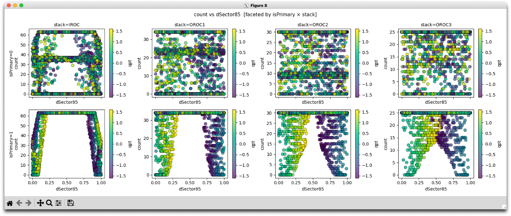

# TrackTools

**TrackTools** is a home for reusable C++ track utilities in ALICE O2. Its purpose is to make common, physics-motivated track calculations available consistently to reconstruction, O2Physics analyses and calibration. More utilities can be added without changing the role of the package.

**TrackGeometry** is the first component. It evaluates reconstructed tracks at requested detector radii and, for the TPC, estimates geometrically crossed, dead, edge-excluded and available pad rows and corresponding track lengths. This README documents **TrackGeometry**, not the scope of all future TrackTools components.

## TrackGeometry: physics motivation

**Shorter usable tracks generally mean worse tracking and PID performance:** less dE/dx information and poorer PID resolution, reduced reconstruction efficiency, potentially greater fit/PID biases and fake associations, and larger differences between data, simulation and reconstruction passes. We need to **quantify these effects track by track**, not merely describe them. TrackGeometry supplies common geometry-derived observables that analysts can use to study and select the *usable* portion of a track while separating geometric acceptance from reconstruction and calibration effects.

A concrete Run 3 example is the **TPC sector-edge pad treatment**. In some early reconstruction passes, two pads at a sector boundary were treated as edge pads rather than one as in the earlier treatment. Edge-pad positions and amplitudes are intrinsically less reliable. Inflated cluster-position uncertainties reduce their contribution to the track fit, and excluding these pads from dE/dx shortens the segment available for PID. Charging-up and steep space-charge distortion gradients can amplify such effects. Later reconstruction changes appear to have alleviated part of the problem, but the exact treatment **must be checked for each production pass**; the library does not presume a correction date.

The practical analysis question is therefore: *how many TPC pad rows, or how much track length, remain available if we exclude inactive regions and an adjustable guard near the **physical active-pad edge**?* A two-pad versus one-pad scenario can be studied by choosing guard widths appropriate to the detector geometry and reconstruction settings; **pad count is not itself a universal width in centimetres**. TrackGeometry provides the quantities for both selections, so one can correlate their effects with efficiency, fake rate, dE/dx resolution, PID biases and data/MC or pass-to-pass differences.

A related, complementary measurement is the TPC cluster bitmask in TrackQA: eight bits summarize the 152 pad rows in eight groups of 19; in the current definition a bit is set when **more than five associated clusters** occur in that group. It can support studies of segment PID and potentially overlapping/split tracks, but it does **not** supply exact per-row reconstructed-cluster occupancy. TrackGeometry predicts geometric row availability; the bitmask describes coarse reconstructed-cluster information. Their comparison is useful precisely because the two are different observables.

The same shared C++ component can return a track state and sector coordinate at an arbitrary **reachable** cylindrical radius, relevant to TPC, TRD and TOF studies. TPC-specific Mapper-based row/length acceptance is the first detector specialization; TRD/TOF detector-specific gap or strip acceptance is not implied by the generic query.

The goal is to compute these observables **quickly and with controlled accuracy**, from the standard O2 track representation rather than reproducing tracking formulae in every analysis. In particular:

- **L — stack-local linear approximation:** the candidate **fast** evaluator for repeated TPC row/length selections.
- **H — analytic helix:** constant-field reference against which the L approximation can be quantified.
- **K — O2 Propagator:** an independent transport reference for the TPC row calculation, requiring properly initialized O2 field conditions. Generic **K0** supplies constant-field O2 transport to a chosen radius.

The practical objective is to establish the phase space where **L is both accurate enough and faster end-to-end**; H-derived endpoint construction must be included in its timing. The implementation supplies the comparison methods; this README does not claim an unmeasured speedup or universal accuracy threshold.

A query at a TRD/TOF radius does **not** automatically calculate TRD chamber acceptance, TOF strip acceptance or arrival time; detector sector counts and phase conventions must be configured explicitly.

## Input and functionality

The preferred input is an existing full `o2::track::TrackPar`: local fitted parameters `(y, z, snp, tgl, q/pT)` at its reference plane `(x, alpha)`. It represents both primary and displaced/secondary tracks; do not replace a secondary's complete state with a primary-vertex approximation. The header also provides a reduced-primary adapter for older applications. All constant-field calls take an **explicit signed `Bz` in kG**, supplied from the data-taking conditions (GRP/CCDB) by the caller.

Include the single component header in a configured O2 environment:

```cpp
#include "TrackGeometry.h"
```

| Capability | Current C++ interface |
|---|---|
| Full track at a reachable cylindrical radius, H | `o2::recohelpers::getParametersAtRadiusH(track, radiusCm, signedBzKG)` |
| Same, constant-field O2 reference K0 | `o2::recohelpers::getParametersAtRadiusK0(track, radiusCm, signedBzKG)` |
| Position/momentum azimuth, inclination, fractional sector coordinate | `statePhiPos(state)`, `statePhiMom(state)`, `stateTgl(state)`, `stateDSector(state, nSectors, sectorPhaseRad)` |
| TPC available rows/length: linear L | `o2::tpc::recohelpers::sectorEdgeStackLinear(track, signedBzKG, cfg)` |
| Same: helix reference H | `o2::tpc::recohelpers::sectorEdgeHelixRows(track, signedBzKG, cfg)` |
| Same: initialized O2 Propagator K | `o2::tpc::recohelpers::sectorEdgeO2PropagatorRows(track, signedBzKG, cfg)` |
| Multiple full local states | `localTrackParametersAtRadiusHBatch`, `localTrackParametersAtRadiusK0Batch`, and `localSectorEdge{HelixRows,StackLinear,O2PropagatorRows}Batch` |

The current candidate exposes the full-`TrackPar` H/L/K TPC row functions. It also retains primary-compatible overloads; the latter are **input adapters**, not separate geometry models. L is a TPC stack approximation, **not** a generic TRD/TOF straight-line propagator.

For a TPC evaluation, `TPCSectorEdgeResult` provides four matching sets of quantities:

| Classification | Predicted pad rows | Approximate trajectory length | Per-row mask |
|---|---|---|---|
| Crossed | `nRowsCrossed` | `lengthCrossedCm` | `crossedMask` |
| Dead: outside Mapper's physical active-pad boundary | `nRowsDead` | `lengthDeadCm` | `deadMask` |
| Excluded: *inside* that boundary, within the configured edge guard | `nRowsExcluded` | `lengthExcludedCm` | `excludedMask` |
| Available: inside the boundary and beyond the guard | `nRowsAvailable` | `lengthAvailableCm` | `availableMask` |

The partition is `Crossed = Dead + Excluded + Available` for row membership and counts; lengths satisfy the corresponding sum up to floating-point roundoff. The masks encode 152 global pad-row indices, subdivided into **IROC (0–62), OROC1 (63–96), OROC2 (97–126), OROC3 (127–151)**, so per-stack counts can be calculated from the appropriate bits. Length estimates are geometric row-thickness contributions, not material-integrated paths.

`TPCSectorEdgeConfig` specifies `guardLowerCm` and `guardUpperCm` (inward distances from the **active-pad edge**, not the nominal sector boundary), `zMaxCm` and `maxSnp` (the *radial-frame* inclination limit, distinct from the local `TrackPar::getSnp()`). The input track's reference radius and the first outward trajectory branch govern which rows are reachable. `stateDSector` returns a **fractional periodic sector coordinate**, not the physical distance to an active pad; supply the actual detector sector count and phase for non-TPC use.

**Check results before using them:** `TrackParametersAtRadius::valid()` for radius queries and `result.status == o2::tpc::recohelpers::SectorEdgeStatus::OK` for row/length queries. The geometry-predicted row opportunities must not be confused with measured associated clusters or the subset of clusters used for PID.

## C++ example 1 — compare two edge exclusions and make independent selections

This is a typical use inside an O2 or O2Physics track loop. `track` is the actual fitted `o2::track::TrackPar`; `signedBzKG`, both guard widths and the cut threshold come from the **run/analysis configuration**. The two output counters are kept separately. Using **two configurations** on the same track makes it possible to compare selections across reconstruction passes or systematic variations.

```cpp
#include "TrackGeometry.h"

// Call this in an O2/O2Physics track loop. The run configuration supplies
// signedBzKG, both guard widths and minAvailableRows.
void countEdgeSelections(const o2::track::TrackPar& track,
                         float signedBzKG,
                         float guard0Cm, float guard1Cm,
                         int minAvailableRows,
                         unsigned& nRejected0, unsigned& nRejected1)
{
  namespace tg = o2::tpc::recohelpers;
  tg::TPCSectorEdgeConfig cfg0;
  cfg0.guardLowerCm = cfg0.guardUpperCm = guard0Cm;
  cfg0.zMaxCm = 250.f; // set from desired longitudinal acceptance
  cfg0.maxSnp = 0.9f;  // radial-frame trajectory stopping criterion

  auto cfg1 = cfg0;
  cfg1.guardLowerCm = cfg1.guardUpperCm = guard1Cm;

  // Two independent predictions for the same complete TrackPar.
  // Use L for selections after verifying its accuracy in your phase space.
  const auto result0 = tg::sectorEdgeStackLinear(track, signedBzKG, cfg0);
  const auto result1 = tg::sectorEdgeStackLinear(track, signedBzKG, cfg1);
  if (result0.status != tg::SectorEdgeStatus::OK ||
      result1.status != tg::SectorEdgeStatus::OK) {
    return; // Handle non-OK tracks separately in your analysis.
  }

  const int nRowsCut0 = result0.nRowsAvailable;
  const int nRowsCut1 = result1.nRowsAvailable;
  const float lengthCut0Cm = result0.lengthAvailableCm;
  const float lengthCut1Cm = result1.lengthAvailableCm;

  if (nRowsCut0 < minAvailableRows) {
    ++nRejected0; // Edge treatment 0: independent selection.
  }
  if (nRowsCut1 < minAvailableRows) {
    ++nRejected1; // Edge treatment 1: independent selection.
  }
  // The same two results allow length-based cuts on lengthCut{0,1}Cm.
  (void)lengthCut0Cm;
  (void)lengthCut1Cm;
}
```

Changing the guard changes **Excluded/Available**, not the physical Mapper **Dead** classification. For a systematic comparison, keep both decisions rather than overwriting the first. If L accuracy for your sample has not yet been established, call `sectorEdgeHelixRows` on the same full track and compare available rows, available length, row masks and selection decisions.

## C++ example 2 — interactive ROOT, one question at a time

This is a **real, user-executed ROOT/Cling session** using the full-5D candidate header, not pseudocode or a compiled macro. It shows the workflow that can then be moved almost unchanged into an O2Physics track loop: start with one track, inspect `dSector`, vary the active-pad-edge guard, read out the available rows and lengths, apply two cuts, and compare L with H.

Start a **fresh ROOT session** in the O2 environment, pointing to the header that implements the full-`TrackPar` overloads. Do not use the old `#include "include/TrackGeometry.h"` from an unsynchronized O2 checkout; that earlier file exposed only the reduced-primary TPC-row signatures.

```bash
ROOT_INCLUDE_PATH="$dEdxAI_CODE/o2reco/cpp${ROOT_INCLUDE_PATH:+:$ROOT_INCLUDE_PATH}" root -l
```

For an installed O2 component, use the corresponding configured O2 header include directory instead. The following expressions are entered **one line at a time** at the ROOT prompt; no multiline `std::cout` statement is required.

### 1. Construct a complete local O2 track and query the 85 cm surface

```cpp
#include "TrackGeometry.h"
#include <iostream>
namespace geo = o2::recohelpers;
namespace tpc = o2::tpc::recohelpers;

const float bzKG = 5.f;
auto track = geo::makeTrackParFromLocalParameters(80.f, 0.12f, -9.5f, 17.f, 0.06f, 0.25f, 0.30f);
auto at85 = geo::getParametersAtRadiusH(track, 85.f, bzKG);
at85.valid()
geo::stateDSector(at85, 18, 0.f)
at85.gz
geo::statePhiMom(at85)
```

Actual ROOT results:

```text
(bool) true
(float) 0.0319329f       // fractional sector coordinate at R=85 cm
(float) 18.1262f         // global z at R=85 cm [cm]
(float) 0.178010f        // global momentum azimuth [rad]
```

`bzKG=+5` is a **synthetic demo setting**, not a production field default. In production obtain the signed field and conditions from the actual run. The initial state is local `(x, alpha, y, z, snp, tgl, q/pT)` and may represent a displaced track; it is not silently reset to the primary vertex. For other detectors use the actual sector count and phase, not necessarily the TPC's `18, 0` convention.

### 2. Define two edge-guard configurations

```cpp
tpc::TPCSectorEdgeConfig cfg0;
cfg0.guardLowerCm = 0.5f;
cfg0.guardUpperCm = 0.5f;
cfg0.zMaxCm = 250.f;
cfg0.maxSnp = 0.9f;
auto cfg1 = cfg0;
cfg1.guardLowerCm = 1.5f;
cfg1.guardUpperCm = 1.5f;
```

Guard distances are **centimetres inward from the Mapper active-pad boundary**, not distances from the nominal 20° sector boundary. The numbers demonstrate a guard scan, not certified conversions of one versus two physical pad widths.

### 3. Calculate available rows and useful length under each guard

```cpp
auto l0 = tpc::sectorEdgeStackLinear(track, bzKG, cfg0);
auto l1 = tpc::sectorEdgeStackLinear(track, bzKG, cfg1);
int(l0.status)
int(l1.status)
l0.nRowsAvailable
l1.nRowsAvailable
l0.lengthAvailableCm
l1.lengthAvailableCm
```

Actual ROOT results:

```text
(int) 0
(int) 0
(unsigned short) 143
(unsigned short) 134
(float) 153.057f
(float) 146.054f
```

For the same reconstructed track, increasing the guard decreases the predicted available rows from **143 to 134**, and the available length from **153.057 to 146.054 cm**. A real analysis should retain non-OK statuses separately rather than treating failed geometry evaluations as accepted rows.

### 4. Make independent analysis selections

```cpp
const int minRows = 140;
bool reject0 = int(l0.status) != 0 || l0.nRowsAvailable < minRows;
bool reject1 = int(l1.status) != 0 || l1.nRowsAvailable < minRows;
reject0
reject1
```

Actual ROOT results:

```text
(bool) false   // 0.5-cm guard: ACCEPT, 143 >= 140
(bool) true    // 1.5-cm guard: REJECT, 134 < 140
```

This is the direct use case for an O2Physics task: compute `nRowsCut0` and `nRowsCut1` from two configurations of the **same fitted `TrackPar`**, then keep both acceptance decisions. `minRows=140` is an **illustrative** threshold to make the difference visible, not a recommended universal analysis cut. Available-length cuts work analogously using `lengthAvailableCm`.

### 5. Quantify how much the fast L method differs from H

```cpp
auto h1 = tpc::sectorEdgeHelixRows(track, bzKG, cfg1);
int(h1.status)
int(h1.nRowsAvailable) - int(l1.nRowsAvailable)
h1.lengthAvailableCm - l1.lengthAvailableCm
```

Actual ROOT results:

```text
(int) 0
(int) 6
(float) 4.58417f
```

For this **near-edge, deliberately demanding example**, H and L differ by **6 available rows and 4.58417 cm**. Thus agreement of H and L must be checked in the analysis phase space before substituting the faster approximation for a cut. No blanket speedup or precision claim follows from a single-track demonstration.

For a generic detector-surface query, the same full-state API also evaluated a state at an illustrative radius of 300 cm in the compiled demonstration:

```cpp
auto at300 = geo::getParametersAtRadiusH(track, 300.f, bzKG);
at300.valid()
```

The 300-cm point is an example cylinder, **not** a claim that TRD/TOF-specific acceptance is implemented. A user can next vary `y`, signed `q/pT`, `tgl`, `guardLowerCm`, `guardUpperCm`, or the requested radius interactively and inspect the resulting quantities. Because these are ordinary C++ calls, they transfer to compiled O2 or O2Physics code without a second geometry implementation.

## Tests included with TrackGeometry

The portable O2/PyROOT tests call the same C++ header. They are intended to be runnable without AliasDataFrame or dfdraw. In the O2 checkout, after loading the matching O2/ROOT environment:

```sh
cd O2/Common/TrackTools                 # replace with your actual checkout path
python -m pytest -q -ra test/python
```

The portable test sources supplied with TrackTools include:

- `test/python/conftest.py`: load the same ROOT environment and `TrackGeometry.h` used by C++.
- `test/python/test_full_state_radius.py`: full 5D H/K0 radius evaluation, independent straight-line truth for displaced tracks, field/charge-sign and invalid-input checks.
- `test/python/test_sector_rows_primary_baseline.py`: TPC Mapper's 152-row accounting, mask partitions, guard monotonicity and the recorded row-centre expected failure.
- `test/python/test_full_state_tpc_rows.py` **in the extended full-5D test set**: full-state H/L, reduced-primary adapter equivalence, displaced tracks, first-outward start radius, scalar/batch parity and field-initialized K smoke checks. Run this file in O2 only once its exact committed version is present in that checkout.

The historical focused full-state portable run was reported as **26 passed, 1 expected failure** in dEdxAI; this is not a statement that the entire O2 test suite or O2 CTest has passed. Test counts belong to the exact source revision and should be updated from the PR's attached log. The row-centre finding is an expected failure, not a passing geometry oracle.

For developers in the canonical **dEdxAI** source tree, the focused tests (including the extended full-state tests) run from the repository root:

```sh
O2RECO_GRP="$dEdxAI_CODE/o2sim_grp.root" \
TRACKTOOLS_INCLUDE="$dEdxAI_CODE/o2reco/cpp" \
python -m pytest -v -ra tests/o2reco/portable_o2/
```

Run the project's canonical `run_tests.sh` and attach its actual output, O2 build status and source revision to the PR/CRR when available. An expected failure for the Mapper row-centre condition is **not** a passing physical validation. The detailed K and row-centre investigations belong in technical review evidence; use method K only with initialized O2 field conditions and appropriate validation.

## Python and AliasDataFrame example

The **optional dEdxAI Python demonstration** calls the C++ TrackGeometry implementation through PyROOT and plots useful TPC geometry observables with AliasDataFrame/dfdraw. These development packages are **not** dependencies of the C++ header or the portable O2 tests.

```python
import importlib
import examples.tracktools_synthetic_5d_demo as demo
importlib.reload(demo)

adfSynthetic = demo.make_synthetic_track_geometry_adf(n_tracks=1000)
adfCounts = demo.make_synthetic_row_counts_adf(adfSynthetic)

sel = ('(input_mode=="5D_full")&(method=="H")&'
       '(state_status==0)&(rows_status==0)&'
       '(observable=="Available")&(stack!="TPC")')

adfCounts.draw(
    "count:dSector85", selection=sel,
    type="scatter", color="qpt", marker="o",
    facet_by=["isPrimary", "stack"], ncols=4,
    auto_title=True, share_y="none"
)
```



*Figure — Synthetic TrackGeometry illustration.* The vertical axis `count` is the **number of geometrically Available pad rows**, not observed clusters; the horizontal axis `dSector85` is the **fractional sector coordinate at R = 85 cm** (not an edge distance); colour encodes signed `q/pT` [(GeV/c)⁻¹]. Each column is one TPC stack and the facets separate true origin-produced primaries (`isPrimary=1`) and displaced secondaries (`isPrimary=0`). The example uses H, full 5D input, a synthetic **+5 kG** field, and **1.5 cm guards** on both active-pad edges. It is a **constructed 50/50 mixture** of 500 primaries transported from `(0,0,0)` to reference radii 78–82 cm, and 500 displaced secondaries sampled around reference `x` positions 79, 80, 81, 105, 145 and 195 cm with ±1.5 cm smearing, broad local `y,z` and random signed curvature. Conditioning on a successful *outward* R=85 cm state removes most secondaries starting at larger radii; it is not a realistic detector-production spectrum. The figure illustrates geometry dependence, **not H–L precision, L timing or measured Ncl**.

To investigate those comparisons in Python, keep the same `adfSynthetic` sample and inspect H versus L available-row and length differences in the data; an H-only scatter plot is not a substitute for the L validation benchmark.

---

**Component status.** `TrackGeometry.h` is the implemented component covered above. Some field/curvature and physical pad-row-centre validation remains under technical review, as does the O2 build/install integration. For the exact current revision, test logs and identified follow-up work, consult the associated PR/CRR rather than treating this user manual as a debugging report.
